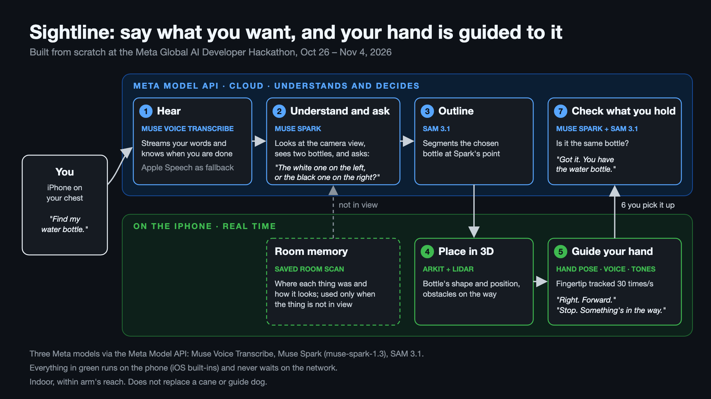

<!-- labels: important -->
# Sightline

> Built from scratch during the **Meta Global AI Developer Hackathon (Oct 26 – Nov 4, 2026)**, Indie Developer track, theme *Build for Your World*. Nothing existed before 2026-10-26; every line of code, test and doc here was written during the event.

Sightline is an iPhone app that guides a blind or low-vision person's hand to the thing they want. Say "find my water bottle". If two bottles are in view, it asks which one. Then it talks your hand there ("Right. Forward. Stop, something's in the way.") and checks that you picked up the right one.

**Demo video:** https://youtube.com/shorts/6mhpoczOCzY

## Architecture

| Step | Component | Kind | Runs where | Job |
|---|---|---|---|---|
| 1 Hear | **Muse Voice Transcribe** (`muse-voice-transcribe-1.0`) | Meta model | Meta Model API, realtime stream | What the user said and when they finished; Apple Speech on the phone only if the stream fails |
| 2 Understand and ask | **Muse Spark** (`muse-spark-1.3`) | Meta model | Meta Model API | Points at the thing the user means in the camera view; when look-alikes are in view, asks which one, describing each |
| 3 Outline | **SAM 3.1** (`sam-3.1`) | Meta model | Meta Model API | Segments the chosen thing at Spark's point |
| 4 Place in 3D | ARKit + LiDAR | iOS built-in | iPhone | The thing's shape and position, obstacles on the way |
| 5 Guide the hand | Vision hand pose, `AVSpeechSynthesizer`, tones | iOS built-in | iPhone, 30 Hz | Tracks one fingertip and speaks short directions; stops the hand before an obstacle |
| 6-7 Check | **Muse Spark** + **SAM 3.1** | Meta models | Meta Model API | Is the thing in the hand the one that was asked for |
| Room memory | Saved room scan (Muse Spark lists each view) | app data | iPhone | Where each thing was and how it looks; used only when the thing is not in view |

The cloud models understand and decide. The guidance loop runs on the phone and never waits on the network. No other AI models are called.

## Run it, tests and details

Everything is in [`sightline/`](sightline/): setup with your own Meta Model API key, unit tests, the simulator, the device test log and the design rules. Start with [`sightline/README.md`](sightline/README.md).

Indoor, within arm's reach. Sightline does not replace a cane or guide dog and gives no medical advice.
